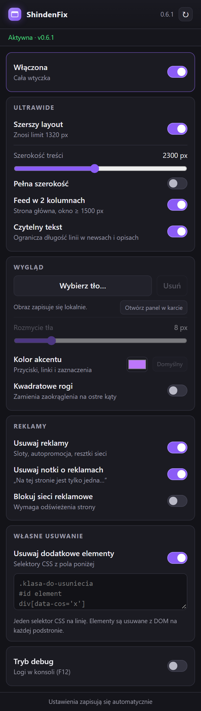

# ShindenFix

Wtyczka do przeglądarek Chromium (Chrome, Edge, Brave, Opera), która poprawia **shinden.pl**: szeroki layout, czyszczenie reklam, blokada ściany Ad-Shield i personalizacja wyglądu. Działa na **każdej podstronie** serwisu — bez listy adresów.



---

## Funkcje

### Ultrawide i czytelność
- **Szerszy layout** — zdejmuje limit szerokości 1320 px i wykorzystuje cały monitor.
- **Szerokość treści** — suwak 1320–3440 px (domyślnie **2300 px**).
- **Pełna szerokość** — 100% okna, niezależnie od suwaka.
- **Feed w kolumnach** — strona główna: 2 kolumny (feed ≥ 1500 px), 3 kolumny (feed ≥ 2600 px).
- **Czytelny tekst** — ogranicza długość linii w newsach; opis anime ma połowę szerokości, tekst do lewej, a każde zdanie zaczyna się od nowej linii.
- Przy szerokim oknie karuzela okładek, logo, panel użytkownika, prawy pasek i slider newsów rozciągają się na całą szerokość ekranu.

### Wygląd
- **Własne tło** — PNG/JPG/WebP; obraz jest zmniejszany i zapisywany lokalnie. Tło jest przyklejone (`position: fixed`), więc nie przewija się razem ze stroną.
- **Rozmycie tła** — suwak 0–40 px.
- **Kolor akcentu** — własny kolor przycisków, linków, tagów, aktywnych narzędzi, linii komentarzy, wierszy odcinków, stopki i wyszukiwarki. „Domyślny” przywraca fiolet.
- **Kwadratowe rogi** — ostre kąty kart, przycisków, tagów i pól; zdjęcia profilowe oraz licznik powiadomień pozostają okrągłe.

### Reklamy, bramki i ściany
- **Usuwaj reklamy** — sloty reklamowe, autopromocja shindena, „wyskakujące” reklamy, resztki sieci reklamowych.
- **Usuwaj notki o reklamach** — komunikaty typu „Na tej stronie jest tylko jedna nasza reklama…”.
- **Blokuj sieci reklamowe** — reguły sieciowe dla Criteo, Społeczności, Google Ads i innych (wymaga odświeżenia strony).
- Automatyczne **„Pokaż playery”** — wtyczka sama zaznacza wymaganą zgodę i klika bramkę anty-adblock przed playerami.
- **Blokada ściany Ad-Shield** („Zezwól na reklamy w tej witrynie”, `html-load.com` / `error-report.com`) — wtyczka blokuje jej pliki, przekierowanie i czyszczenie strony. Ściana nie ma szans się pokazać.
- Usuwa ramkę „Nie otwieraj plików pobranych…”, rozmazane tło nagłówka anime, kafelek „Wbij na Discord” oraz komunikaty anty-adblock.
- Obserwuje DOM (`MutationObserver`) i powtarza czyszczenie, więc reklamy nie wracają.

### Własne usuwanie
- Pole na **własne selektory CSS** (jeden na linię) — każdy pasujący element jest usuwany z DOM na każdej podstronie, bez edycji kodu.

---

## Instalacja

1. Pobierz **`ShindenFix-v0.6.1.zip`** z sekcji [Releases](../../releases/latest) → **Assets**.
2. Rozpakuj archiwum (np. do `Dokumenty\ShindenFix`). W środku jest folder `ShindenFix` z plikiem `manifest.json`.
3. Wejdź na:
   - Chrome: `chrome://extensions`
   - Brave: `brave://extensions`
   - Edge: `edge://extensions`
   - Opera: `opera://extensions`
4. Włącz **Tryb programisty**.
5. Kliknij **Załaduj rozpakowane** i wskaż rozpakowany folder `ShindenFix`.
6. Odśwież shinden.pl (**Ctrl+Shift+R**).

Ikona wtyczki pojawi się na pasku — kliknięcie otwiera panel ustawień.

> **Dlaczego ZIP, a nie `.crx`?** Chrome i Brave blokują instalację plików `.crx` spoza sklepu (błąd `CRX_REQUIRED_PROOF_MISSING`). ZIP + „Załaduj rozpakowane” to jedyna pewna metoda instalacji poza sklepem.

### Aktualizacja
Po podmianie plików na nowsze: `brave://extensions` (lub `chrome://extensions`) → **↻ Przeładuj** przy ShindenFix → odśwież stronę. Panel wtyczki pokazuje numer wersji i status „Aktywna · v…”.

### Wymagania
- Chromium **111+** (Chrome, Edge, Brave, Opera).
- Firefox nie jest oficjalnie wspierany (MV3 może wymagać drobnych poprawek).

---

## Prywatność

- Wtyczka **nie wysyła niczego na żaden serwer**, nie zawiera analityki i nie zbiera danych.
- Ustawienia i obraz tła trafiają wyłącznie do `chrome.storage.local`; kopia ustawień leży też w `localStorage` shindena, żeby layout nie mrugał przy wczytywaniu.
- Obraz tła nigdzie nie jest wysyłany — zostaje na Twoim komputerze.

---

## Struktura

```
manifest.json
icons/
src/
  base.css            – layout ultrawide (ładowany przed DOM)
  config.js           – ustawienia domyślne i listy selektorów
  content.js          – layout, czyszczenie reklam, bramka, obserwacja DOM
  gate-main.js        – helper w świecie strony (bramka + blokada ściany Ad-Shield)
  popup.html/.css/.js – panel ustawień
  rules/ads.json      – opcjonalna blokada sieci reklamowych (DNR)
  rules/adshield.json – blokada infrastruktury Ad-Shield (DNR, zawsze aktywna)
```

**Wersja:** 0.6.1
